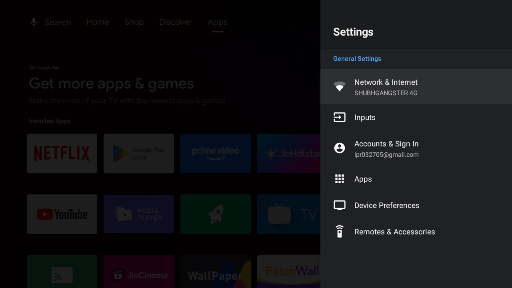
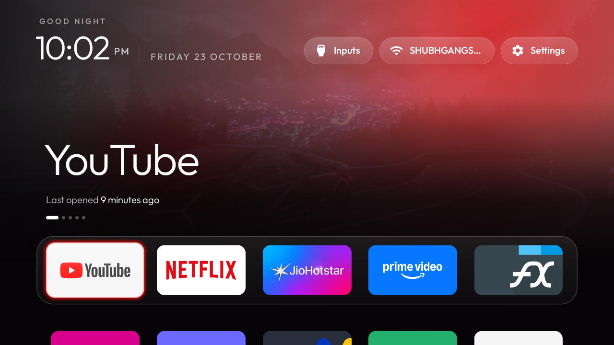

# Clean TV UI — Xiaomi Mi TV 4C/4A Pro (Android TV 9)

Complete debloat, ad-blocking, and custom launcher setup for **Xiaomi MiTV-AXSO0 (dangal)** on Android TV 9.

---

## 🌟 Highlights & End Result

- **No Ads & No Bloat:** Completely disabled Xiaomi PatchWall, analytics, sponsored recommendations rows, and telemetry.
- **Private DNS Ad-blocking:** Enabled `dns.adguard.com` at system level to block tracker and ad domains in all streaming apps.
- **Clean Apple-TV Style Launcher:** Replaced heavy stock launcher with lightweight, fluid CleanYourTV launcher (~445 KB).
- **Custom Dock:** Pinned top streaming apps: **YouTube → Netflix → JioHotstar → Prime Video**.
- **Dynamic 4K Wallpapers:** Auto-rotating 4K wallpaper slideshow (Supercar, Northern Lights, Milky Way) every 10 minutes with frosted glass dock styling.
- **Memory Optimization:** Increased free RAM by over 40% with reduced background CPU cycles.

---

## 📸 Screenshots

| Before (Cluttered Stock Home) | After (Clean TV UI Launcher) |
|---|---|
|  |  |

---

## 📂 Repository Structure

- **`tv-cleanup/`**: Debloat package lists, before/after memory logs, and full screenshots.
  - `step1-ads-tracking.txt`: Disabled tracking, analytics, and PatchWall.
  - `step2-xiaomi-services.txt`: Disabled Xiaomi background services.
  - `step3-preloaded-apps.txt`: Disabled unused preloaded apps.
  - `step4-streaming-apps.txt`: Configuration for preloaded streaming apps.
- **`cleanyourtv/`**: Source code of the CleanYourTV launcher, automated build & deployment scripts, and themes.
  - `cleanyourtv/themes/custom-slideshow/`: Custom theme with 4K wallpapers and dock settings.
- **`TV_CLEANUP_PLAN.md`**: Full architecture plan, choices, safe lists, and undo instructions.

---

## 🔄 Reverting / Undo Instructions

All packages were disabled rather than permanently uninstalled, allowing instant rollback:

- **Restore Stock Launcher:**
  ```powershell
  cleanyourtv\tools\restore.ps1 -TvHost <TV_IP>
  ```
- **Reset Theme to Default:**
  ```powershell
  cleanyourtv\tools\theme.ps1 -TvHost <TV_IP> -Reset
  ```
- **Re-enable Any Disabled Package:**
  ```powershell
  adb shell pm enable --user 0 <package_name>
  ```
